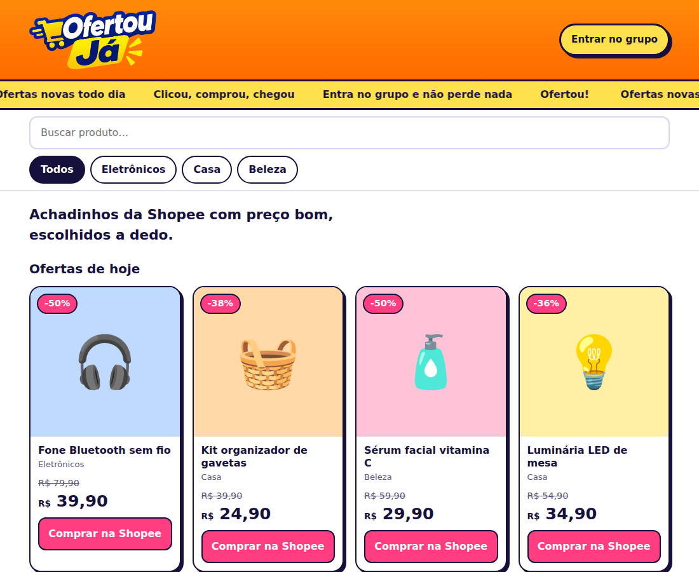
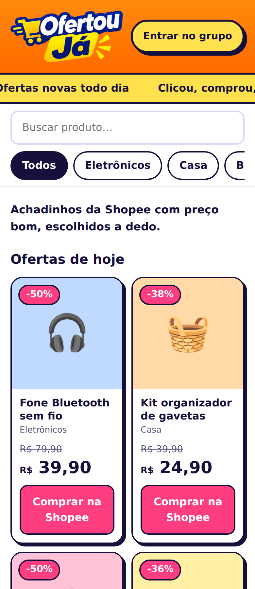

# Ofertou Já

Vitrine de achadinhos (Shopee, Shein, Mercado Livre) com links de afiliado. É um site parado (HTML, CSS e JavaScript puro), sem servidor e sem banco de dados, feito para ser hospedado de graça no GitHub Pages.

Endereço previsto: **ofertouja.com.br**

<p align="center">
  
</p>

<p align="center">
  
</p>

> Os prints foram tirados com produtos de exemplo e fontes do sistema. No navegador, com internet, a fonte do site é a Bricolage Grotesque, do Google Fonts.

---

## Sumário

1. [O que o site faz](#o-que-o-site-faz)
2. [Como funciona o modelo de afiliado](#como-funciona-o-modelo-de-afiliado)
3. [Estrutura de arquivos](#estrutura-de-arquivos)
4. [Como abrir no computador](#como-abrir-no-computador)
5. [Como trocar os produtos](#como-trocar-os-produtos)
6. [Como trocar o link do grupo do WhatsApp](#como-trocar-o-link-do-grupo-do-whatsapp)
7. [Como mudar cores e visual](#como-mudar-cores-e-visual)
8. [Como subir no GitHub pelo VS Code](#como-subir-no-github-pelo-vs-code)
9. [Como publicar com GitHub Pages](#como-publicar-com-github-pages)
10. [Como ligar o domínio ofertouja.com.br](#como-ligar-o-domínio-ofertoujacombr)
11. [Cuidados importantes](#cuidados-importantes)
12. [Próximos passos](#próximos-passos)
13. [Autor](#autor)

---

## O que o site faz

- Mostra os produtos em cards, com foto (emoji por enquanto), nome, categoria, preço e botão **Comprar na [loja]**.
- Mostra etiqueta de desconto (ex.: `-50%`) e o preço antigo riscado, quando o produto tem preço antigo cadastrado. A porcentagem é calculada sozinha.
- Tem **busca** por nome e **botões de categoria** (Todos, Casa, Beleza...). As categorias aparecem sozinhas a partir da lista de produtos.
- A busca fica no alto, à esquerda, numa faixa amarela logo abaixo da faixa que corre. Os botões de categoria ficam fixos no topo quando a pessoa rola a página.
- Topo laranja com o logo e o botão para entrar no grupo do WhatsApp.
- Faixa grande e colorida com frases de oferta correndo para a direita, e um boneco (original) correndo atrás (a animação é desligada para quem usa "reduzir movimento" no celular).
- Layout que se adapta: 2 colunas no celular, 3 no tablet e 4 no computador.
- Aviso de afiliado no rodapé.

## Como funciona o modelo de afiliado

1. A pessoa vê o produto no site.
2. Clica em **Comprar na [loja]** e vai para a loja pelo link de afiliado.
3. Se ela comprar, o dono do site ganha uma comissão. A pessoa **não paga nada a mais** por isso.

Por isso o preço mostrado no site deve ser **o mesmo da Shopee**. O preço antigo (`antes`) só deve ser preenchido quando for o preço real que aparece lá, para o desconto ser verdadeiro. Os preços da Shopee mudam sem aviso, então vale revisar a lista de tempos em tempos.

## Estrutura de arquivos

```
ofertouja/
├── index.html      estrutura da página
├── style.css       todo o visual
├── script.js       lista de produtos, busca e categorias
├── logo.png        logo (fundo transparente)
├── README.md       este arquivo
├── .gitignore      lista do que NÃO pode ir para o GitHub
└── docs/
    ├── autor.jpg               foto usada no rodapé e neste README
    ├── screenshot-desktop.png  print do site no computador
    └── screenshot-celular.png  print do site no celular
```

| Arquivo | Para que serve |
|---|---|
| `index.html` | Define o que existe na página: topo, faixa, busca, lista, rodapé. Os produtos **não** ficam aqui, o JavaScript desenha eles. |
| `style.css` | Cores, tamanhos, bordas, sombras e o comportamento no celular. As cores principais ficam no começo, dentro de `:root`. |
| `script.js` | Guarda a lista `produtos`, filtra por categoria e busca, e desenha os cards na tela. |
| `logo.png` | Imagem do logo, sem fundo. O laranja que aparece atrás vem do CSS. |
| `.gitignore` | Impede subir por engano senhas, pastas de login do WhatsApp e `node_modules`. |

## Como abrir no computador

Não precisa instalar nada. Dê dois cliques no `index.html` e ele abre no navegador.

No VS Code, também dá para instalar a extensão **Live Server**, clicar com o botão direito no `index.html` e escolher **Open with Live Server**. A página atualiza sozinha toda vez que você salva um arquivo.

## Como trocar os produtos

Abra o `script.js`. No começo tem a lista:

```js
const produtos = [
  {nome:"Fone Bluetooth sem fio", cat:"Eletrônicos", preco:39.90, antes:79.90, emoji:"🎧", cor:"#BFD9FF", link:"https://shopee.com.br/"},
  ...
];
```

Cada produto tem estes campos:

| Campo | O que é | Exemplo |
|---|---|---|
| `nome` | Nome que aparece no card | `"Fone Bluetooth sem fio"` |
| `cat` | Categoria. Se você inventar uma nova, o botão dela aparece sozinho | `"Eletrônicos"` |
| `preco` | Preço atual, **com ponto** e sem R$ | `39.90` |
| `antes` | Preço antigo, **opcional**. Se apagar, some o desconto e o riscado | `79.90` |
| `emoji` | Desenho do card, enquanto não tem foto | `"🎧"` |
| `cor` | Cor de fundo do card, em hexadecimal | `"#BFD9FF"` |
| `loja` | De qual loja é o produto (aparece no card e no botão) | `"Shopee"` |
| `link` | Seu link de afiliado | `"https://s.shopee.com.br/xxxx"` |

Para **adicionar** um produto, copie uma linha inteira, cole embaixo e troque os valores. Cuidado com a vírgula no fim de cada linha, exceto a última.

Para **remover**, apague a linha do produto.

## Como trocar o link do grupo e o destino dos botões

No começo do `script.js` ficam duas configurações:

```js
const LINK_GRUPO = "https://chat.whatsapp.com/SEU-LINK-AQUI";
const MODO = "grupo";
```

- `LINK_GRUPO`: troque pelo link de convite do seu grupo do WhatsApp. Ele é usado no botão do topo e nos botões dos produtos.
- `MODO`: define para onde os botões dos produtos levam.
  - `"grupo"`: todos levam para o grupo (o botão fica escrito **Pegar no grupo**).
  - `"loja"`: cada botão leva para o campo `link` do produto (o botão fica escrito **Comprar na Shopee**, **Comprar na Shein** etc., conforme o campo `loja`).

Para passar do grupo para a Shopee depois, basta trocar `"grupo"` por `"loja"` e conferir se cada produto tem o seu link de afiliado.

## Produtos próprios (3D)

A parte **Nossos produtos 3D** fica abaixo dos achadinhos (que são o foco) e usa a lista `produtosProprios`, no começo do `script.js`.

| Campo | O que é |
|---|---|
| `nome` | Nome do produto |
| `desc` | Descrição curta |
| `preco` | Preço, com ponto (ex.: `29.90`) |
| `emoji` e `cor` | Desenho e cor do fundo, enquanto não tem foto |
| `foto` | Caminho da foto na pasta `docs` (ex.: `"docs/suporte.jpg"`). Se ficar `""`, usa o emoji |
| `comprar` | Link de pagamento do produto. Se ficar `""`, o botão mostra **Em breve** |

O site é parado (GitHub Pages), então o pagamento em si acontece na página do serviço de pagamento (Mercado Pago, PagBank, InfinitePay...). Crie um link de pagamento para cada produto lá e cole no campo `comprar`.

## Lista de produtos automática (produtos.json)

O site lê o arquivo `produtos.json`. Quem escreve nele é o **robô do WhatsApp** (pasta `robo-ofertou`, fora deste repositório), que lê o grupo e atualiza o arquivo e a pasta `fotos/` pela API do GitHub.

- Com o `produtos.json` vazio, o site mostra "Os achadinhos de hoje estão chegando!".
- A lista de exemplo do `script.js` só aparece se o `produtos.json` não puder ser lido (por exemplo, abrindo o `index.html` direto no computador).
- Para cadastrar produtos na mão, edite a lista `produtos` no `script.js` **e apague o `produtos.json`**, ou escreva os produtos dentro do próprio `produtos.json`.
- Depois que o robô estiver rodando, antes de dar **Sincronizar Alterações** no VS Code, o Git vai trazer as mudanças dele (`produtos.json` e `fotos/`) para o seu computador. Isso é normal.

## Como mudar cores e visual

No começo do `style.css`:

```css
:root{
  --bg:#FFFFFF;      /* fundo da página */
  --ink:#16103D;     /* cor do texto e das bordas */
  --pop:#FFE14D;     /* amarelo (faixa e botão do topo) */
  --hot:#FF3D81;     /* rosa do botão Comprar */
}
```

Troque os valores e salve. Para o topo laranja, procure `.hero` e mude o `linear-gradient`. Para o tamanho do logo, procure `.logo img` e mude o `200px`.

## Como subir no GitHub pelo VS Code

### 1. Preparação (uma vez só)

- Instale o **Git**: git-scm.com
- Crie uma conta no **github.com**
- No VS Code, abra a pasta do projeto: **Arquivo > Abrir Pasta**

### 2. Criando o repositório pelo menu do VS Code

1. Clique no ícone **Controle do Código-Fonte** (terceiro ícone da lateral esquerda) ou aperte `Ctrl+Shift+G`.
2. Clique em **Inicializar Repositório**.
3. Escreva uma mensagem, por exemplo `primeira versão do site`, e clique em **Commit**. Se ele perguntar sobre "stage", aceite.
4. Clique em **Publicar Branch**. O VS Code pede para você entrar na conta do GitHub.
5. Escolha **Publish to GitHub public repository**. O repositório precisa ser **público** para usar o Pages de graça.

### 3. Ou pelo terminal (Ctrl + ' no VS Code)

Antes, crie um repositório vazio no github.com (botão **New**), e troque `SEU-USUARIO` abaixo:

```bash
git init
git add .
git commit -m "primeira versão do site"
git branch -M main
git remote add origin https://github.com/SEU-USUARIO/ofertouja.git
git push -u origin main
```

### 4. Atualizando depois

Sempre que mudar algo:

```bash
git add .
git commit -m "troca produtos"
git push
```

Dica: faça commits pequenos, um por mudança, com mensagens que expliquem o que mudou.

## Como publicar com GitHub Pages

1. No repositório, vá em **Settings > Pages**.
2. Em **Build and deployment**, escolha **Deploy from a branch**.
3. Escolha a branch `main` e a pasta `/ (root)`, e clique em **Save**.
4. Espere 1 a 3 minutos. O endereço aparece na mesma tela, parecido com `https://SEU-USUARIO.github.io/ofertouja/`.

## Como ligar o domínio ofertouja.com.br

Primeiro, no GitHub:

1. Em **Settings > Pages > Custom domain**, escreva `ofertouja.com.br` e salve. O GitHub cria um arquivo chamado `CNAME` no repositório. Se der erro, crie você mesmo um arquivo `CNAME` com só uma linha: `ofertouja.com.br`.

Depois, no Registro.br, na parte de **DNS** do domínio, use os servidores DNS do Registro.br e crie estes registros:

| Tipo | Nome | Valor |
|---|---|---|
| A | (vazio, ou @) | 185.199.108.153 |
| A | (vazio, ou @) | 185.199.109.153 |
| A | (vazio, ou @) | 185.199.110.153 |
| A | (vazio, ou @) | 185.199.111.153 |
| CNAME | www | SEU-USUARIO.github.io |

Os menus do Registro.br mudam de vez em quando. Confira também a documentação oficial do GitHub sobre domínio personalizado, porque os endereços IP podem ser atualizados.

Por fim, volte em **Settings > Pages** e ative **Enforce HTTPS** quando a opção liberar. A propagação pode levar de alguns minutos até 24 horas.

## Cuidados importantes

- **O repositório é público.** Qualquer pessoa pode ler o código. Nunca coloque senha, chave de API ou dados de login do WhatsApp nele. O `.gitignore` já bloqueia os nomes mais comuns, mas confira antes de subir.
- **Os links de afiliado aparecem no site** de qualquer jeito, então não há problema neles estarem no código.
- **O GitHub Pages serve só arquivos parados.** Não roda robô nem servidor.
- **Marca registrada:** o site cita Shopee, Shein e Mercado Livre. Leia as regras do programa de afiliados sobre o uso do nome e do logo deles.
- **Preços:** as lojas mudam preço e estoque sem aviso. Revise a lista de vez em quando.

## Próximos passos

- [ ] Colocar o link real do grupo do WhatsApp em `LINK_GRUPO`
- [ ] Trocar os produtos de exemplo pelos produtos reais
- [ ] Trocar os emojis por fotos dos produtos
- [ ] Mudar `MODO` para `"loja"` quando os links de afiliado estiverem prontos
- [ ] Ligar o domínio `ofertouja.com.br`
- [ ] Criar um robô que lê as postagens do grupo e atualiza a lista de produtos sozinho (rodando em um servidor ou computador à parte, não no GitHub Pages)

## Autor

<table>
  <tr>
    <td></td>
    <td><strong>Vinicius Levi Pereira</strong><br>Quem fez o site</td>
  </tr>
</table>
